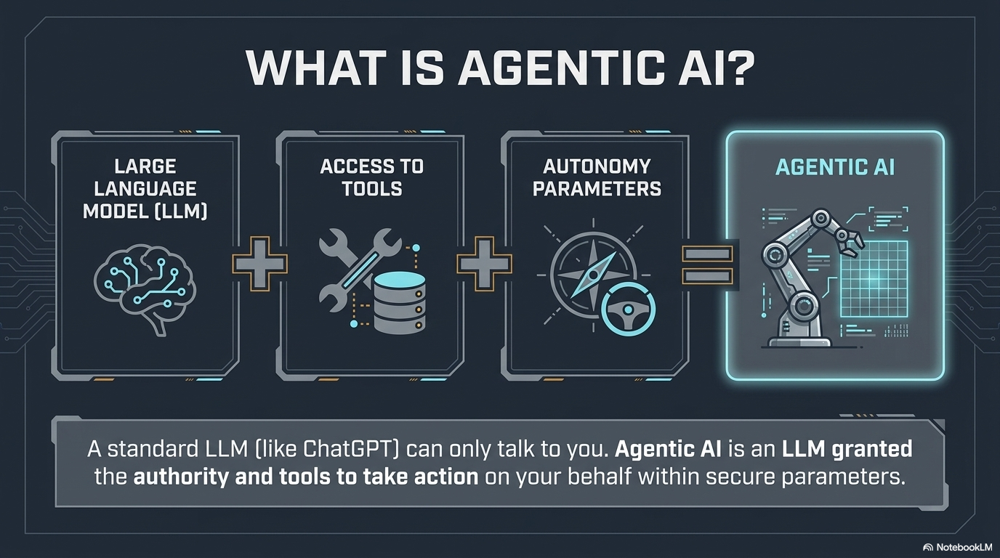

# What Is Agentic AI?

---

## From Chatbot to Agent

| Chatbot | Agent |
|---------|-------|
| Waits for your question | Takes a goal and works toward it - /goal release "Software" v1.0.0 - explicitly follow established milestones in Github|
| Gives one answer | Iterates through multiple steps |
| Can only talk | Can use tools |
| Generates text | Takes action |

---

## Instructor Visual: What Is Agentic AI?



---

## The Agent Loop

```
    ┌──────────┐
    │  THINK   │ ← Understand the goal
    └────┬─────┘
         │
    ┌────▼─────┐
    │   PLAN   │ ← Break it into steps
    └────┬─────┘
         │
    ┌────▼─────┐
    │   ACT    │ ← Execute a step (write code, run command, search)
    └────┬─────┘
         │
    ┌────▼─────┐
    │ OBSERVE  │ ← Check the result
    └────┬─────┘
         │
         └──────── Repeat until done
```

The agent doesn't just generate one answer — it works through a problem step by step, checking its own work along the way.

---

## What Makes an Agent an Agent: Tools

An AI agent has access to tools:

- **File system** — read and write files
- **Terminal** — run commands and scripts
- **Web browser** — search for information and documentation
- **MCP servers** — interact with external applications
- **Code execution** — write, run, test, and debug code

Without tools, it's a chatbot. With tools, it's a collaborator.

---

## Why This Matters for Your Mission

You don't need to learn to code. You do need to learn to iterate through dev/test cycles quickly - historically called DevOps. If you or your agent breaks something, the agent can probably fix the issue within minutes. The costs of engineering are changing drastically along with our risk tolerances.

You need to learn to **describe what you want clearly**. Explain what you think you want to an agent and have it summarize, then iterate - iterate - iterate.

The agent handles the implementation. You review, guide, test and iterate. Multiple agents can work together with multiple humans on a project at the same time. Try not to give entire complex tasks to a single agent - learn to break the tasks up.

---

## "Vibe Coding" vs. Disciplined Development

| Vibe Coding | Spec-Driven Development |
|-------------|------------------------|
| "Hey AI, build me a tool" | Define requirements first, then build |
| Hope for the best | Verify against the spec |
| No structure | Constitution → Spec → Plan → Tasks |
| Hard to reproduce | Reproducible and auditable |
| Fragile results | Reliable results |

We'll show you the disciplined approach shortly.
