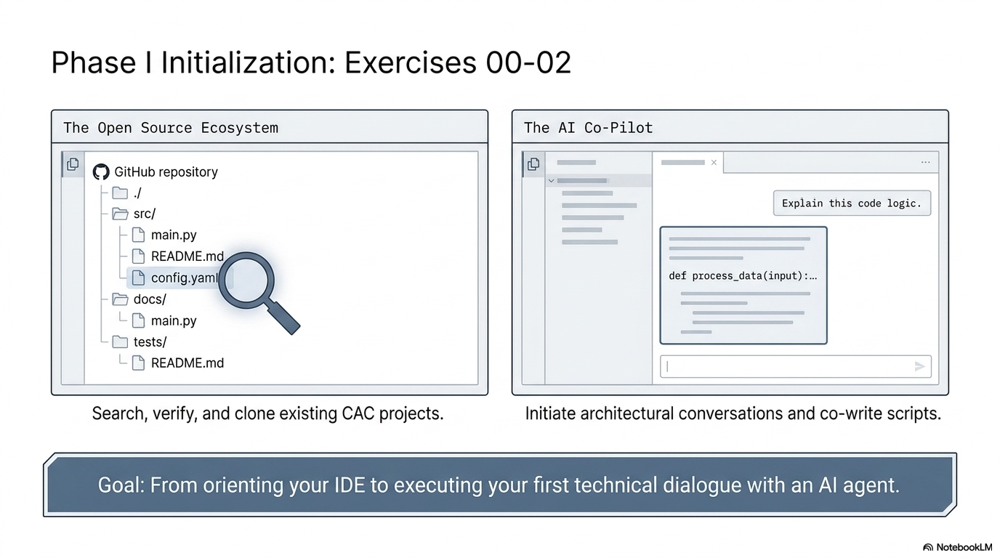

# Exercise 2: Cursor First Steps

**Duration:** 15 minutes
**Goal:** Get comfortable working with your AI agent (the instructor uses Cursor) while using the Project VIC template as your actual lab workspace

## Instructor Visual



## Step 1: Have a Conversation

Open your agent's chat. In Cursor, open the agent panel (Cmd/Ctrl+L or click the chat icon). In a terminal agent such as Claude Code, Codex, or Gemini CLI, start it in your project folder.

Try these prompts one at a time. Read the agent's response before moving to the next.

### Prompt 1: Ask the agent to explain your workspace
> Read START-HERE.md, QUICKSTART.md, AGENTS.md, and prompts/START-AGENT-HERE.md in this project. Explain what this template is for and what I should do before asking you to build anything.

Notice how the agent provides a structured, informative answer. This is the agent working as a **knowledge resource**.

### Prompt 2: Ask it to explain code
> Can you explain what this Python code does?
>
> ```python
> import json
>
> def parse_cybertip(xml_path):
>     """Parse a CyberTip XML file and extract key fields."""
>     import xml.etree.ElementTree as ET
>     tree = ET.parse(xml_path)
>     root = tree.getroot()
>     tips = []
>     for report in root.findall('.//report'):
>         tip = {
>             'id': report.get('id'),
>             'date': report.findtext('dateReceived'),
>             'subject': report.findtext('subject'),
>         }
>         tips.append(tip)
>     return tips
> ```

Notice how the agent explains each part in plain language. You don't need to understand the code to understand what it does — the agent bridges that gap.

### Prompt 3: Ask a concept question
> What is the CASE ontology and how is it used in digital forensic investigations?

Notice how the agent provides a structured, informative answer. This is the agent working as a **knowledge resource**.

## Step 2: Watch the Agent Use Tools

Ask the agent:

> Read the README.md file in this project and summarize what this repository is for.

Watch the agent panel. You'll see it:
1. **Read** the file (using the file system tool)
2. **Analyze** the contents
3. **Summarize** in natural language

This is the agent using tools — reading files is one of its most basic capabilities. In later exercises, you'll see it write files, run commands, search the web, and interact with external applications.

## Step 3: Agent as Research Assistant

Ask the agent:

> What is the difference between a UI, CLI, API, and MCP? Give me a one-sentence summary of each, with an example from law enforcement.

Compare the agent's answer to what you learned in the lecture. The agent is now your **on-demand reference** — you can ask it to clarify or expand on any concept.

## Step 4: Agent as Code Generator

Ask the agent:

> Create a small Python script called scratch/hello_investigator.py that:
> 1. Asks for the investigator's name
> 2. Asks for their agency
> 3. Prints a welcome message
> 4. Prints today's date and time
>
> Then explain the file you plan to create before creating it, and run it.

Watch the agent:
1. **Write** the script (working ON the project)
2. **Run** the script (working IN the project)
3. **Show** you the output

This is the "working ON and IN simultaneously" concept from the lecture — the agent created the tool and then used it, all in one interaction.

## Step 5: Iterate

The output might not be exactly what you want. Try:

> Can you modify scratch/hello_investigator.py to also ask what type of case they're working on (ICAC, cyber fraud, etc.) and include that in the output?

Watch how the agent reads the existing file, understands the changes needed, and modifies it. This is the **iterative** nature of working with an agent — you guide, it implements, you refine.

## Step 6: Give the Agent Rules

The agent is powerful, but without guidance it makes its own assumptions. **Agent rules** are written instructions the agent reads every time you prompt it. They make the agent's behavior predictable and consistent.

### See the Existing Policies

The template already has Project VIC development policies in `policies/`. They are plain Markdown, so every agent can read them. `AGENTS.md` lists them all, and small adapter files deliver them to each tool (for example `.cursor/rules/` for Cursor, `CLAUDE.md` for Claude Code, and `GEMINI.md` for Gemini CLI). Ask the agent:

> Read AGENTS.md, then explain the purpose of policies/student-mode.md, policies/security-compliance.md, and policies/speckit-workflow.md. Which of these does your tool load automatically, and how?

Notice the structure of each policy:
- A **front-matter header** with `description`, `alwaysApply`, and sometimes `globs` (file patterns where the policy applies)
- A **body** written in plain language describing how the agent should behave

Core policies (`alwaysApply: true`) apply to every prompt. That's why the agent can stay aligned to the Project VIC workflow, security boundaries, and spec-driven development approach.

### Create Your First Rule

Now create your own rule. Ask the agent:

> Create a new policy file at policies/no-real-data.md with this front matter:
> - description: "Never use real personal data, case data, or victim information; all examples must use synthetic data"
> - alwaysApply: true
>
> In the body, explain that this is a law enforcement training environment, all data must be synthetic, and the agent should generate realistic but fictional names, dates, and case numbers when examples are needed. Then show me the command `python3 scripts/sync_agent_rules.py`, explain what it does, and run it after I approve.

After the script runs, open `policies/no-real-data.md` and read it. Then look at what the script generated: `.cursor/rules/no-real-data.mdc`, a new row in the `AGENTS.md` policy index, and a new import line in `CLAUDE.md` and `GEMINI.md`. One source file, delivered to every agent. Start a new chat so your agent loads the updated rules.

### Test Your Rule

Ask the agent something that would trigger the rule:

> Create a sample evidence log entry for a seized laptop.

Check: Did the agent use synthetic data (fictional names, made-up case numbers)? The rule should have guided it to do so automatically, without you having to remind it.

### Key Takeaway on Rules

- In this template, rules live in `policies/` as Markdown files; `scripts/sync_agent_rules.py` delivers them to Cursor, Claude Code, Codex, Copilot, Gemini CLI, and other agents
- Cursor's own format is `.cursor/rules/*.mdc`; other agents use `AGENTS.md`, `CLAUDE.md`, `GEMINI.md`, or `.github/copilot-instructions.md`
- The agent reads core rules **every time** you send a prompt
- You can add and adjust rules over time as you learn what the agent needs
- You can build a **library of rules** and reuse them across projects
- Rules guide an agent but do not force it; you still review what it does
- Rules complement spec-driven development — specs guide individual features, rules guide everything

## Done When

- [ ] You had a conversation with the agent about the template workspace and course concepts
- [ ] You watched the agent use tools (reading files, running commands)
- [ ] You created and ran `scratch/hello_investigator.py`
- [ ] You iterated on the script (agent modified existing code)
- [ ] You read the template's policies and understood their structure
- [ ] You created `policies/no-real-data.md`, ran the sync script, and tested the rule

## What You Just Did

You experienced the AI agent as:

1. **A knowledge resource** — answering questions about concepts
2. **A code explainer** — making technical code accessible
3. **A research assistant** — summarizing and clarifying
4. **A code generator** — writing software from your description
5. **A tool user** — reading files and running commands
6. **An iterative collaborator** — refining based on your feedback
7. **A rule-following collaborator** — behaving predictably when given written rules

The agent is not a black box. You see what it does. You approve or redirect. You give it rules, and it follows them. You are in control.

This is the collaborator you'll use for the rest of the lab — and for building mission tools after you leave.
